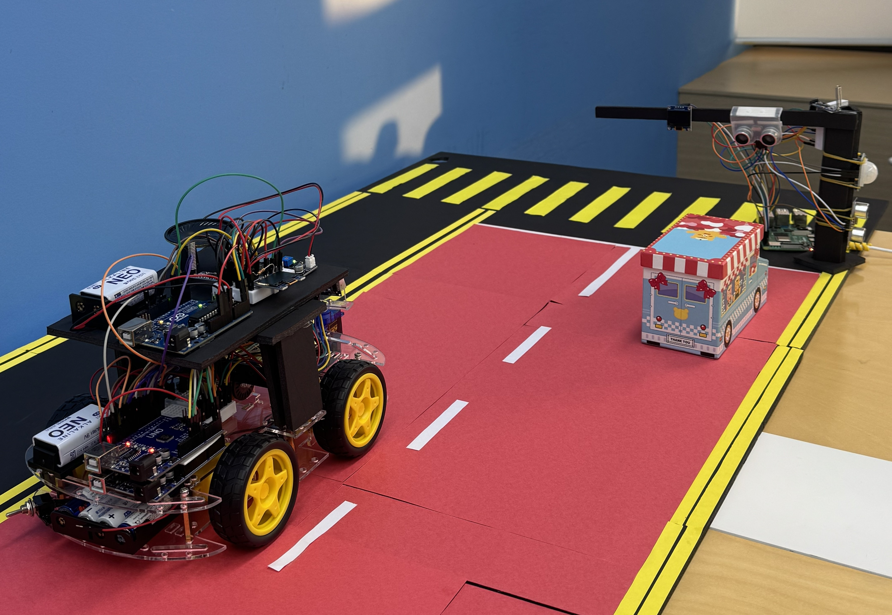
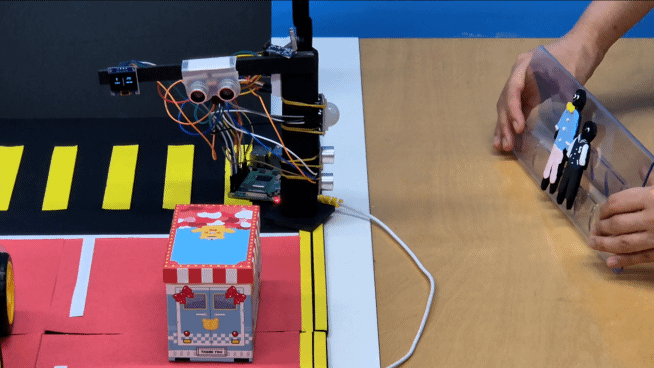
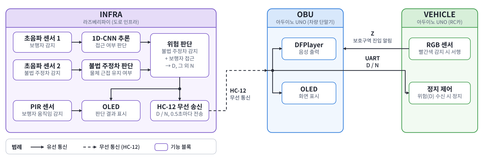

# 스쿨존 사각지대 보완 시스템

불법 주정차로 생긴 사각지대에서 보행자의 접근을 감지하고 차량에 위험을 알리는 V2I 프로토타입입니다. 
아두이노 UNO와 라즈베리파이4를 메인으로 사용하였습니다.

  
  

## 소개

사각지대에서 발생하는 교통사고를 예방하기 위해서는 운전자가 직접 주변을 감지하고 인식해야 한다는 수동적인 한계가 있습니다.

본 프로젝트는 감지의 주체를 운전자에서 도로 인프라로 바꾸었습니다. 도로 인프라(RSU)에 설치한 센서가 사각지대를 먼저 감지하고, 위험하다고 판단하면 차량 단말기(OBU)에 신호를 전달합니다. 이 구조를 미니어처 환경에서 구현하였습니다.

위험 판단 기준은 다음과 같습니다.

- 불법 주정차가 감지된 상태에서, 보행자가 사각지대 쪽으로 접근한다고 판단되면 차량 단말기에 위험 신호(`D`)를 전송합니다.
- 위험 조건이 해제되면 일정 시간(2초) 뒤 정상 신호(`N`)를 전송합니다.

## 시스템 구조

## 레포지토리 구조

해당 폴더의 자세한 내용은 각 README에서 확인할 수 있습니다.

| 폴더 | 역할 | 주요 하드웨어 | 상세 문서 |
|------|------|---------------|-----------|
| [`INFRA/`](./INFRA) | 도로 인프라(RSU): 보행자 접근 판단, 불법 주정차 감지, 위험 신호 전송 | 라즈베리파이4, 초음파 센서, PIR 센서, OLED 디스플레이, 통신 모듈 | [INFRA/README.md](./INFRA/README.md) |
| [`OBU/`](./OBU) | 차량 단말기(OBU): 인프라 신호 수신, 음성 및 화면 안내, RC카 제어 신호 전달 | 아두이노 UNO, DFPlayer, OLED 디스플레이, 통신모듈 | [OBU/README.md](./OBU/README.md) |
| [`VEHICLE/`](./VEHICLE) | RC카: 어린이 보호구역 감지 시 서행, 위험 신호 수신 시 정지 | 아두이노 UNO, 모터 드라이버, RGB센서, 초음파 센서 | [VEHICLE/README.md](./VEHICLE/README.md) |

| 폴더 및 파일 | 설명 |
|--------------|------|
| [`collect/`](./collect) | 학습 데이터 수집용 시나리오 생성(`make_scenarios.py`) 및 수집 코드(`collect.py`) |
| [`data/raw/`](./data/raw) | 수집한 거리 시계열 원본 데이터(`data.csv`) |
| [`model/`](./model) | 1D-CNN 모델 정의 코드(`model.py`) |
| `cnn_model.pt` | 최종 모델 파일 |

## 동작 흐름

1. 차량이 어린이 보호구역(빨간색 바닥 표시)에 진입하면 RC카가 서행하고, 단말기에 보호구역 진입을 알립니다.
2. 인프라는 초음파 센서로 보행자의 거리 변화를 20Hz로 측정하고, 2초 길이의 윈도우를 1D-CNN에 입력해 접근 여부를 판단합니다.
3. 별도의 초음파 센서가 불법 주정차(25cm 이내 물체가 2초 이상 유지)를 감지합니다.
4. 두 조건이 동시에 충족되면 '위험'으로 판단해 OBU로 `D`를 전송하고, 아닌 경우에는 `N`을 전송합니다.
5. 단말기는 음성과 화면으로 안내하고, RC카는 위험 신호를 받으면 정지합니다.

## 모델

| 항목 | 내용 |
|------|------|
| 구조 | 1D-CNN, 2채널 |
| 입력 | 거리 시계열 40샘플(20Hz, 2초)과 마스크 값 |
| 출력 | 3클래스: 0 정지, 1 접근, 2 이탈 |
| 보정 | 출력한 3개 클래스 점수 중 접근 점수에만 0.5를 더한 뒤, 가장 높은 점수의 클래스를 최종 판정으로 선택 |

> 모델의 학습 코드(`train/`)는 이 레포에 포함되어있지 않습니다.

## 데이터 수집

- 초음파 센서로 직접 물체를 이동해가며 거리를 측정합니다.
- 시나리오 100개를 `collect/make_scenarios.py`로 생성합니다. 시나리오 하나는 20초 길이이며 4개 구간으로 구성되고, 한 번에 25cm씩 이동합니다.
- 구간의 종류에는 '정지(1)', '걷기(2)', '뛰기(3)', '이탈(4)'이 있습니다.
- 보행자 이동 속도는 메트로놈(120BPM)에 따라 기준을 세웁니다. 걷기는 25cm당 3초(6박), 뛰기는 25cm당 1초(2박)입니다.
- `collect/collect.py`가 초음파 센서 값을 0.05초(20Hz) 간격으로 400샘플 측정합니다. 측정 범위는 3cm에서 150cm입니다.
- 수집한 거리와 라벨은 `data/raw/data.csv`에 시나리오 단위로 저장되어 있습니다.
- 최종 모델에서는 걷기와 뛰기를 접근 하나로 합쳐 3클래스로 사용합니다.
